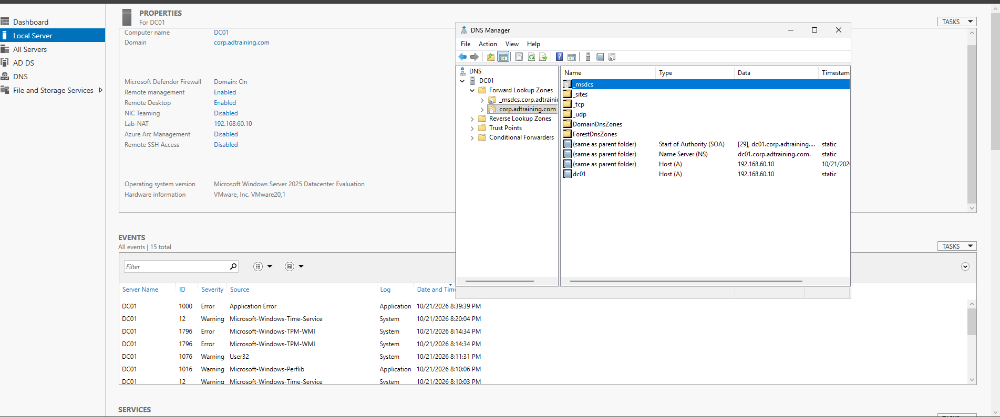
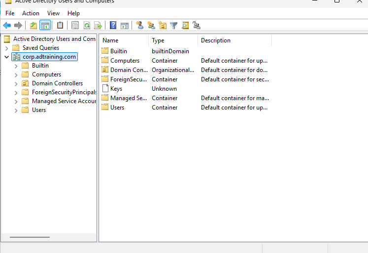
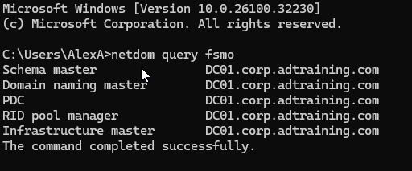

# Windows Server 2025 & Active Directory Foundation

## Objective

Build a Windows Server domain as the foundation for a simulated
business environment, supporting centralized identity management,
DNS, and future domain-joined servers.

## Lab Environment

| Component | Configuration |
|---|---|
| Hypervisor | VMware Workstation Pro 26H1 |
| Server OS | Windows Server 2025 Datacenter Evaluation |
| Computer name | DC01 |
| VM resources | 8 GB RAM, 8 virtual processors, 80 GB virtual disk |
| Storage | Samsung T7 Shield external SSD |
| Network | VMware NAT |
| IPv4 address | 192.168.60.10 |
| Subnet mask | 255.255.255.0 |
| Default gateway | 192.168.60.2 |
| AD forest and domain | corp.adtraining.com |
| Server FQDN | DC01.corp.adtraining.com |

## Implementation

### 1. Prepare the Virtual Machine

Installed Windows Server 2025 in VMware Workstation and renamed the
Windows computer to `DC01`.

Configured a static IPv4 address so the server could provide a
consistent endpoint for domain and DNS services.

### 2. Install Active Directory Domain Services

Used Server Manager to install the Active Directory Domain Services
role and its management tools.

Started the domain-controller promotion wizard and selected
**Add a new forest**, using:

```text
corp.adtraining.com
```

Included DNS Server during promotion and configured a Directory
Services Restore Mode recovery password.

### 3. Resolve the Prerequisite Failure

The promotion prerequisite check reported that the built-in
Administrator account's password did not meet requirements.

Set a password for that account and reran the prerequisite check.
Promotion then proceeded, and the server restarted.

The Administrator login password and DSRM recovery password serve
different purposes.

### 4. Verify the Domain Configuration

After restarting, verified that Local Server displayed:

- Computer name: `DC01`
- Domain: `corp.adtraining.com`
- IPv4 address: `192.168.60.10`


### 5. Inspect DNS and Active Directory

Confirmed the domain's forward lookup zone contained DC01's
host record pointing to `192.168.60.10`.



Opened Active Directory Users and Computers and confirmed the
domain and its default containers were available.



## Domain Discovery Validation

Used these commands to check DNS service discovery and locate the
domain controller:

```powershell
nslookup -type=SRV _ldap._tcp.dc._msdcs.corp.adtraining.com.
nltest /dsgetdc:corp.adtraining.com
```

The SRV lookup identified `dc01.corp.adtraining.com` at
`192.168.60.10`, and `nltest` completed successfully.

## FSMO Role Discovery

Queried the current FSMO role holders:

```powershell
netdom query fsmo
```

All five roles were held by `DC01.corp.adtraining.com`:

| Role | Current holder |
|---|---|
| Schema Master | DC01 |
| Domain Naming Master | DC01 |
| PDC Emulator | DC01 |
| RID Master | DC01 |
| Infrastructure Master | DC01 |



This exercise documented role ownership; it did not include a
role transfer or seizure.

## Troubleshooting Notes

| Issue | Action and result |
|---|---|
| Bridged networking produced a 169.254 address with no gateway | Switching to NAT allowed the VM to obtain a valid DHCP lease. The underlying bridged-network issue was not isolated. |
| Domain-controller promotion failed its password prerequisite | Set the built-in Administrator password, reran the check, and completed promotion. |

## Outcome

Established the `corp.adtraining.com` domain with DC01 providing
Active Directory Domain Services and DNS. Verified domain
membership, DNS host registration, domain-controller discovery,
and FSMO role ownership.

This server became the foundation for subsequent DNS, identity,
Group Policy, DHCP, and IIS exercises.

## Scope and Limitations

- This is a single-domain-controller learning environment.
- A second domain controller, replication, and failover have not
  been demonstrated.
- Additional roles share DC01 for lab convenience; this layout is
  not a production deployment recommendation.

[Back to project overview](README.md)
