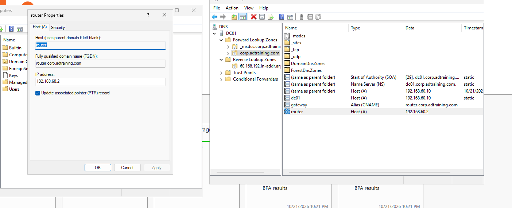
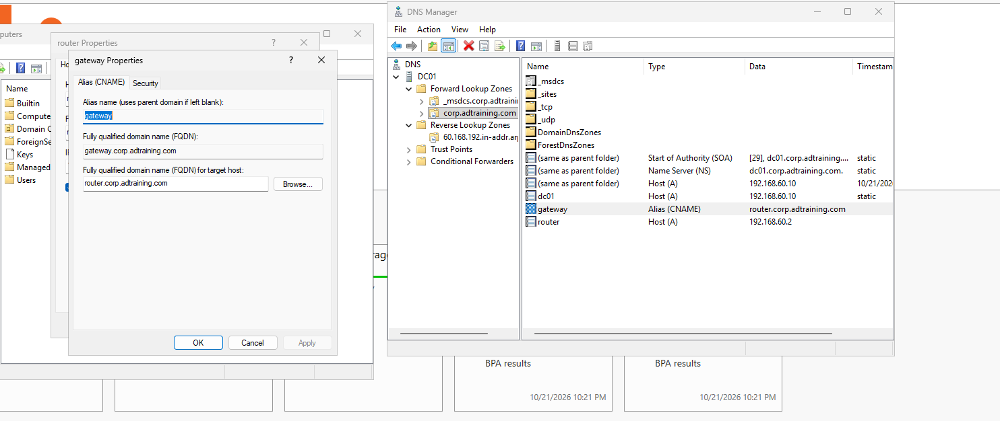
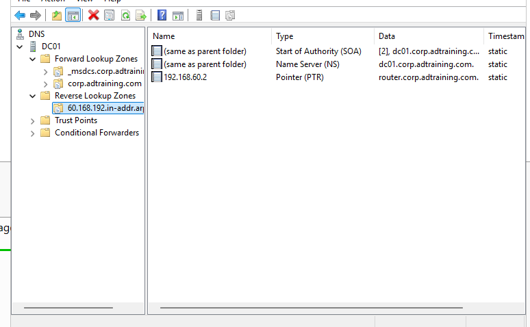
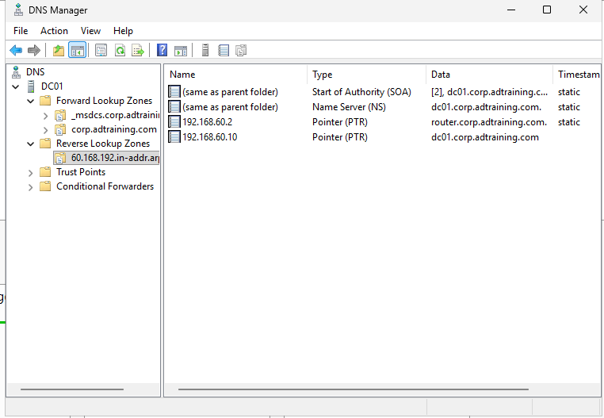
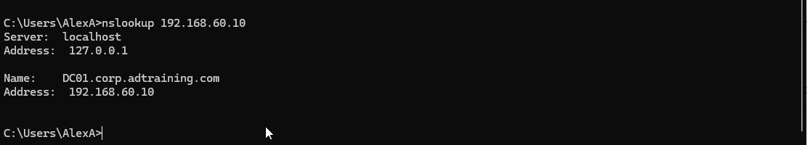

# DNS Records & Name Resolution

## Objective

Configure and validate forward, alias, and reverse DNS records
within the Active Directory lab.

## Environment

| Component | Configuration |
|---|---|
| DNS server | DC01.corp.adtraining.com |
| Server IP | 192.168.60.10 |
| Forward lookup zone | corp.adtraining.com |
| Reverse lookup zone | 60.168.192.in-addr.arpa |
| Lab subnet | 192.168.60.0/24 |
| VMware NAT gateway | 192.168.60.2 |

## Records Configured

| Type | Name or address | Target |
|---|---|---|
| A | router.corp.adtraining.com | 192.168.60.2 |
| CNAME | gateway.corp.adtraining.com | router.corp.adtraining.com |
| PTR | 192.168.60.2 | router.corp.adtraining.com |
| PTR | 192.168.60.10 | dc01.corp.adtraining.com |

## Implementation

### 1. Create an A Record

Created a host record named `router` in the
`corp.adtraining.com` forward lookup zone, pointing to
`192.168.60.2`.

This assigns a readable DNS name to the existing VMware NAT
gateway. It does not create a new router or change routing.



### 2. Create a CNAME Record

Created an alias named `gateway`, pointing to:

```text
router.corp.adtraining.com
```

The alias provides another name for the same host without
maintaining a second IP-address mapping.



### 3. Create the Reverse Lookup Zone

Created an IPv4 reverse lookup zone for the network ID:

```text
192.168.60
```

DNS Manager represents this zone as:

```text
60.168.192.in-addr.arpa
```

Added a PTR record mapping `192.168.60.2` back to
`router.corp.adtraining.com`.



### 4. Add DC01's PTR Record

Added a second PTR record mapping:

```text
192.168.60.10 → dc01.corp.adtraining.com
```

Corrected a typo in the target hostname before validating the
record.



## Validation

### Forward Lookup

```powershell
nslookup router.corp.adtraining.com.
```

Returned:

```text
Name:    router.corp.adtraining.com
Address: 192.168.60.2
```

### Alias Lookup

```powershell
nslookup gateway.corp.adtraining.com.
```

Returned the canonical hostname `router.corp.adtraining.com`,
address `192.168.60.2`, and `gateway.corp.adtraining.com` as an alias.

### Gateway Reverse Lookup

```powershell
nslookup 192.168.60.2
```

Returned `router.corp.adtraining.com`.


### DC01 Reverse Lookup

```powershell
nslookup 192.168.60.10
```

Returned `DC01.corp.adtraining.com` and `192.168.60.10`.



## Troubleshooting: DNS Suffix Searching

An external lookup initially returned an answer for:

```text
facebook.com.adtraining.com
```

rather than the intended `facebook.com`.

Inspected the client configuration and nslookup settings:

```powershell
ipconfig /all
```

Then, in an interactive nslookup session:

```text
nslookup
set all
```

The search list included `corp.adtraining.com` and
`adtraining.com`, with suffix searching enabled.

Tested the exact external name using a trailing dot:

```powershell
nslookup facebook.com.
```

Also tested within an interactive session:

```text
set nosearch
facebook.com
```

Both approaches returned an answer for the intended
`facebook.com` name. The `set nosearch` change applied only
to that nslookup session.

This isolated suffix searching as the reason for the different
lookup result. It did not require changing the AD domain.

## DNS Forwarding

The captured configuration used `192.168.60.2`, VMware's NAT DNS
service, as DC01's forwarder.

A forwarder is an upstream DNS service that DC01 can ask for
names it cannot resolve locally. Website IP addresses returned
by nslookup are answers, not forwarder entries.

Successful external resolution confirmed that DC01 could answer
the query. It did not independently establish whether a particular
answer came from cache, forwarding, or another resolution path.

## Outcome

Validated:

- Hostname-to-IP resolution using an A record.
- Alias resolution using a CNAME record.
- IP-to-hostname resolution using PTR records.
- Exact-name external DNS resolution.
- DNS suffix-search behavior during troubleshooting.

DNS resolution tests verify name mappings; they do not by
themselves prove application availability or network connectivity.

[Previous: Active Directory Foundation](01-active-directory-foundation.md)
|
[Back to project overview](README.md)
