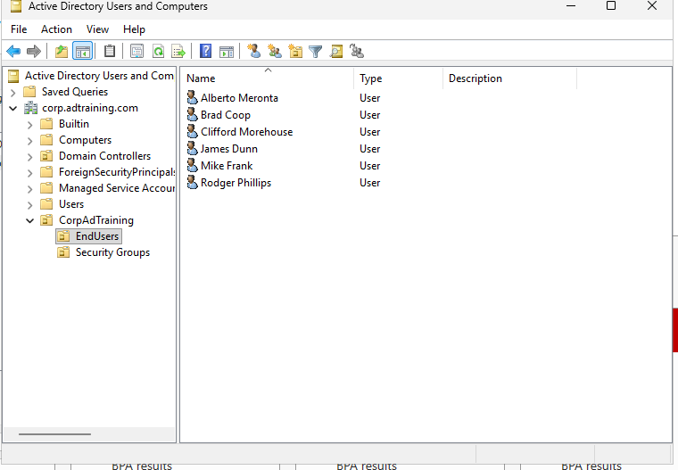
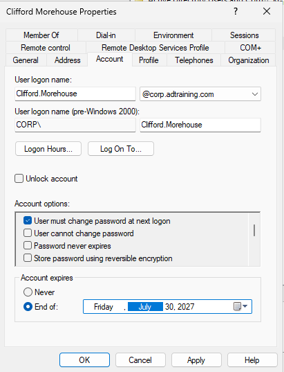
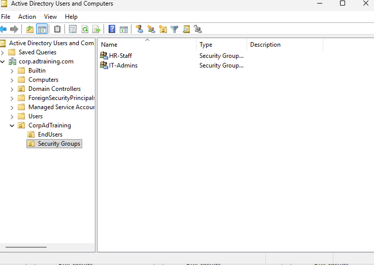
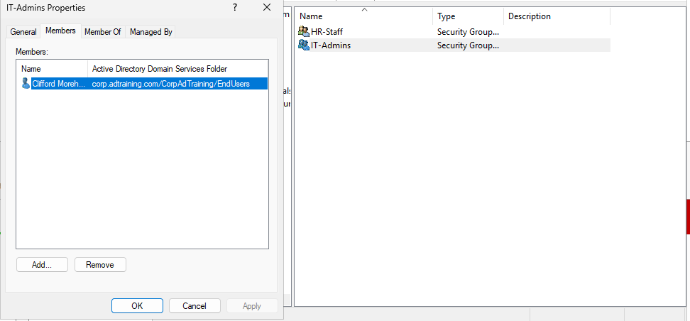
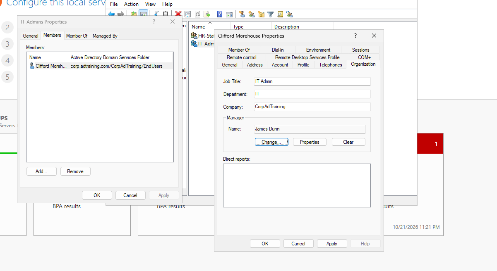

# Active Directory Users, Groups & Organizational Units

## Objective

Organize directory objects and practice employee account creation, account settings, and security-group membership in `corp.adtraining.com`.

## Directory Structure

```text
corp.adtraining.com
└── CorpAdTraining
    ├── EndUsers
    │   ├── Alberto Meronta
    │   ├── Brad Coop
    │   ├── Clifford Morehouse
    │   ├── James Dunn
    │   ├── Mike Frank
    │   └── Rodger Phillips
    └── Security Groups
        ├── HR-Staff
        └── IT-Admins
```

## Implementation

### Organize Objects with OUs

Used Active Directory Users and Computers on DC01 to create `CorpAdTraining`, then the child OUs `EndUsers` and `Security Groups`. This separates user accounts from group objects and provides a location for later user-policy links.



### Create User Accounts

Created six accounts within EndUsers. Clifford Morehouse is the documented sample account:

| Setting | Captured value |
|---|---|
| User principal name | `Clifford.Morehouse@corp.adtraining.com` |
| Legacy logon name | `CORP\Clifford.Morehouse` |
| Description | IT Admin |
| Must change password at next logon | Selected |
| Password never expires | Not selected |
| Account expiration | End of July 30, 2027 |

The expiration setting is specific to this practice account, not a requirement for every employee account. Account expiration and password expiration are separate controls.



The General-tab capture also contains profile fields. Its email value lacks an `@` sign and should be corrected or left blank before treating it as a completed profile. Contact fields are not needed to demonstrate account creation.

### Create Groups and Assign Membership

Created `HR-Staff` and `IT-Admins` security groups in the Security Groups OU.



Added Clifford Morehouse to IT-Admins and inspected the Members tab to verify membership.



A group named IT-Admins does not automatically have administrator privileges. Membership groups accounts together; permissions must be assigned separately. The screenshots do not establish group scope or effective administrative access.

### Practice Organization Attributes

Entered IT as Clifford's department, IT Admin as the job title, CorpAdTraining as the company, and James Dunn as manager.



This capture shows Apply available, so it documents the entered values rather than independently proving those organization edits were saved.

## Validation and Remaining Work

Verified the presence of six user objects, two security groups, and Clifford's IT-Admins membership through the directory console. Account settings are captured with Apply disabled.

- [ ] Capture each group's General tab to establish scope and type explicitly.
- [ ] Verify HR-Staff membership if used in a later exercise.
- [ ] Demonstrate a test-user sign-in on a suitable domain-joined machine.
- [ ] Test group-based resource access when file shares are introduced.

## Outcome

Built an organized directory structure and practiced account lifecycle settings and group membership. This provides the identity foundation for later policy and access-control exercises.

[Previous: DNS Administration](02-dns-administration.md) | [Project overview](README.md) | [Next: Group Policy](04-group-policy.md)
