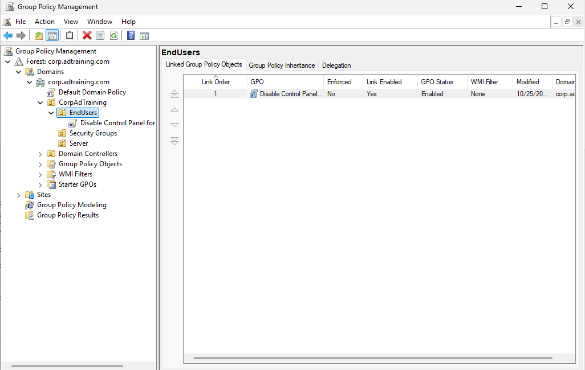
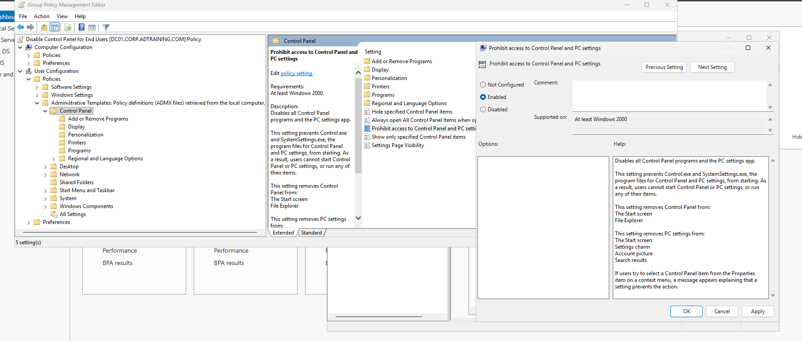

# Group Policy: Restrict Control Panel Access

## Objective

Configure a user policy that restricts access to Control Panel and PC settings for accounts in the EndUsers OU.

## Configuration

| Component | Value |
|---|---|
| Domain | `corp.adtraining.com` |
| GPO | Disable Control Panel for End Users |
| Link location | CorpAdTraining / EndUsers |
| Link enabled | Yes |
| GPO status | Enabled |
| Enforced | No |
| WMI filter shown | None |

## Implementation

### Create and Link the GPO

In Group Policy Management, created the GPO and linked it to EndUsers. The captured link is enabled with link order 1.



The OU link places the policy in scope for users in that OU, subject to filtering, inheritance, and processing conditions. It does not automatically target every user in the domain.

### Configure the User Setting

Opened the GPO editor and navigated to:

```text
User Configuration
└── Policies
    └── Administrative Templates
        └── Control Panel
            └── Prohibit access to Control Panel and PC settings
```

Selected Enabled. This setting is designed to prevent the affected user from opening Control Panel and the Settings application.



The screenshot shows Apply available. It captures the Enabled selection but does not independently prove persistence after saving.

## Validation Status

**Configuration documented; user enforcement not yet tested.**

The course section ended after configuration. A linked GPO and editor screenshot do not prove that a user's session received the setting.

## Planned Test

1. Reopen the setting to verify it was saved as Enabled.
2. Use an intended EndUsers account on a suitable domain-joined client or member machine where it is permitted to sign in.
3. Refresh user policy or sign out and back in as appropriate.
4. Capture a user-scope policy report identifying the applied GPO.
5. Attempt to open Control Panel and capture the restriction.

Do not grant ordinary users interactive logon to DC01 simply to test this policy.

## Outcome

Practiced creating a GPO, choosing a user setting, and linking it to an OU. Effective application remains a planned validation step.

[Previous: Identity Administration](03-identity-administration.md) | [Project overview](README.md) | [Next: DHCP](05-dhcp.md)
