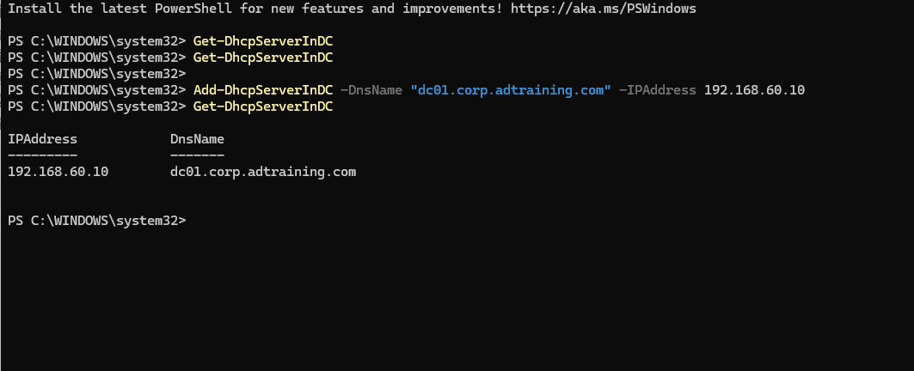
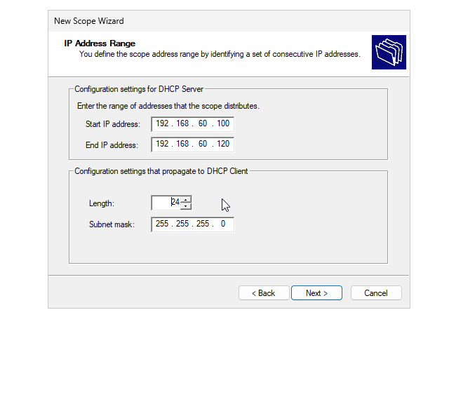
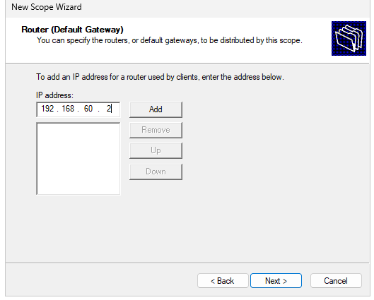

# DHCP Server Authorization & Scope Configuration

## Objective

Install DHCP on DC01, register it as an authorized server in Active Directory, and configure a client address scope for the VMware lab.

## Network Plan

| Setting | Value |
|---|---|
| DHCP server | `dc01.corp.adtraining.com` |
| Server static IP / DNS server | `192.168.60.10` |
| Subnet | `192.168.60.0/24` |
| Default gateway | `192.168.60.2` |
| Scope name entered | `LAN_Network` |
| Windows scope range entered | `192.168.60.100–192.168.60.120` |
| Addresses in range | 21 |
| VMware DHCP pool previously observed | `192.168.60.128–192.168.60.254` |

Separate pools avoid overlapping allocations but do not stop both DHCP servers from answering clients. VMware DHCP must be coordinated before Windows DHCP is used for lease validation.

## Install and Authorize DHCP

Installed DHCP Server through Server Manager and started the post-install configuration wizard. Security-group creation succeeded, but the initial authorization attempt reported error 20070: the DHCP service could not contact Active Directory.

### Check Domain Discovery

Ran:

```powershell
nslookup -type=SRV _ldap._tcp.dc._msdcs.corp.adtraining.com.
nltest /dsgetdc:corp.adtraining.com
```

Both succeeded and identified DC01 at `192.168.60.10`. This established working domain discovery at test time, not the cause of the earlier authorization error.

### Resolve the Authorization Block

An authorization-list query in the earlier account/session returned PermissionDenied / WIN32 5. After signing in as `CORP\Administrator` and using elevated PowerShell, the query returned no authorized entries.

Registered DC01 and queried the list again:

```powershell
Add-DhcpServerInDC -DnsName "dc01.corp.adtraining.com" -IPAddress 192.168.60.10
Get-DhcpServerInDC
```

The result listed `dc01.corp.adtraining.com` at `192.168.60.10`.



Rerunning the wizard later returned error 20079 stating the server was already present in the directory service, consistent with this registration. Restarted the DHCP Server service; post-install configuration was subsequently reported complete.

## Configure the Scope

### Address Range

Entered `.100–.120` with prefix length 24 and mask `255.255.255.0`. This keeps the pool separate from DC01's static `.10` and the proposed member-server address `.20`.



### Router Option

Entered `192.168.60.2` on the Router page. The user confirmed clicking Add after the captured screen.



The image captures entry before the address appeared in the list. Final saved options need separate verification.

For domain clients, the intended DNS option is DC01 at `192.168.60.10`, and the intended DNS domain is `corp.adtraining.com`; these options have not yet been evidenced in the completed scope.

## Validation Status

| Item | Status |
|---|---|
| AD authorization-list registration | Verified with PowerShell |
| Scope range | Captured in wizard |
| Gateway added | User confirmed; final saved option unverified |
| Post-install completion | User reported complete |
| Final scope state and activation | Not verified |
| Client lease from DC01 | Not tested |

Authorization permits a DHCP server to operate in the AD environment; it does not prove an active scope or successful lease delivery.

## Remaining Work

- [ ] Verify scope completion and saved options, including router, DNS server, and DNS domain.
- [ ] Coordinate VMware DHCP before activating the Windows scope.
- [ ] Request a lease from a separate test VM.
- [ ] Confirm the client identifies `192.168.60.10` as its DHCP server and receives the expected options.
- [ ] Verify the lease in the DHCP console and test DNS and connectivity.

## Outcome

Authorized DC01 in AD and documented scope configuration. Client address delivery remains unfinished; no successful lease claim is made.

[Previous: Group Policy](04-group-policy.md) | [Project overview](README.md) | [Next: IIS](06-iis.md)
