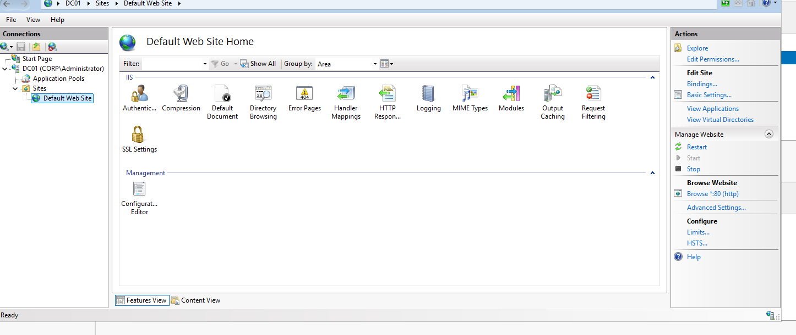

# IIS Web Server Installation & Local Validation

## Objective

Install Internet Information Services on DC01 and verify the Default Web Site serves content locally over HTTP.

## Environment

| Component | Value |
|---|---|
| Server | `DC01.corp.adtraining.com` |
| OS | Windows Server 2025 Datacenter Evaluation |
| Server IP | `192.168.60.10` |
| Website | Default Web Site |
| Observed HTTP binding | `*:80` |
| Test URL | `http://localhost` inside DC01 |

## Implementation

### Install Web Server (IIS)

Installed the IIS role through Server Manager. An installation-success wizard screenshot was not captured, so validation uses the IIS console and a working browser request.

### Inspect the Default Web Site

Opened IIS Manager and selected DC01 > Sites > Default Web Site. The captured Actions pane shows Start disabled and Stop available, indicating the website was running. The Browse action shows HTTP on port 80.



### Test Local HTTP Access

Opened the browser inside DC01 and navigated to:

```text
http://localhost
```

The default IIS welcome page loaded successfully.


Localhost refers to the machine making the request. In this test, the browser and IIS were both running inside DC01.

## Troubleshooting: Red Server Manager Tiles

During setup, multiple role tiles displayed red Manageability alerts. Opening the detail view showed:

```text
Online - Restart pending
```

Restarted Windows Server normally. After startup, Server Manager briefly showed zero roles while collecting inventory. The roles reappeared and the user confirmed the red alerts cleared. Reinstallation was not needed.

This distinguished a server-wide pending-restart status from evidence of individual role failures.

## Validation and Limitations

Verified that the Default Web Site was running and returned its welcome page to a local HTTP request.

Not yet tested:
- Access from the host PC or another VM.
- Network firewall traversal.
- Custom content or hostname bindings.
- HTTPS and certificates.
- Application deployment or authentication.

## Outcome

Established a working local IIS site. This is an introductory web-server exercise, not a demonstration of a production-ready or internet-facing application.

IIS shares DC01 for course practice. A separate member server is a future place to extend web-hosting exercises.

[Previous: DHCP](05-dhcp.md) | [Project overview](README.md)
