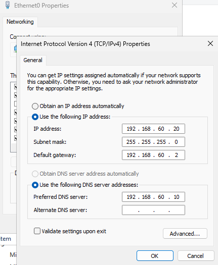
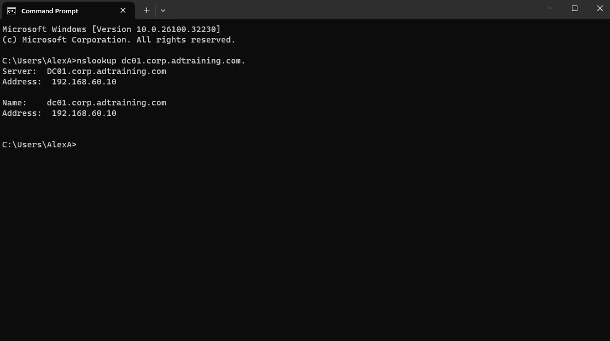
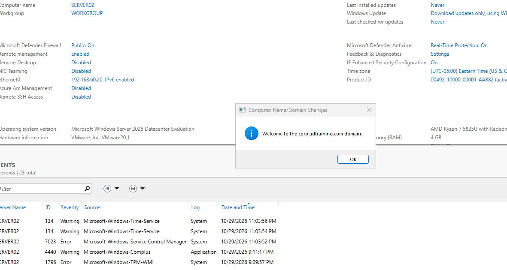

# SERVER02: Member Server Deployment & Domain Join

## Objective

Deploy a second Windows Server VM, configure it to use domain DNS, and join the existing Active Directory domain as a member server for Remote Desktop Services.

## Configuration

| Component | Value |
|---|---|
| Windows computer name | SERVER02 |
| OS | Windows Server 2025 Datacenter Evaluation, Desktop Experience |
| Resources | 4 GB RAM, 2 virtual CPUs, 80 GB virtual disk |
| Storage | Samsung T7 Shield, `D:\Homelab\VirtualMachines\SERVER02` |
| Network | Same VMware NAT network as DC01 |
| Static IP | `192.168.60.20` |
| Subnet mask | `255.255.255.0` |
| Default gateway | `192.168.60.2` |
| Preferred DNS | `192.168.60.10` (DC01) |
| Domain | `corp.adtraining.com` |

## Implementation

### Create and Place the VM

Installed Windows Server from evaluation media. The VM was initially created under OneDrive rather than the intended external drive. While it was powered off, copied the full VM to the T7, verified all source files against the destination using SHA256, and removed the original only after verification passed.

Corrected the VMware display name from SEVER02 to SERVER02. Internal component filenames were retained to preserve disk references. Opened the relocated VM configuration and selected **I moved it**.

The VMware display name and Windows computer name are independent; the Windows computer was also renamed SERVER02.

### Configure Networking and Domain DNS

Assigned a fixed IP and configured SERVER02 to query DC01 for DNS. This lets the member server resolve the internal domain's records rather than depending on a public DNS service for AD discovery.



Tested host resolution:

```powershell
nslookup dc01.corp.adtraining.com.
```

DC01 at `192.168.60.10` answered with its expected hostname and address.



This test established DNS reachability and name resolution, not domain membership by itself.

### Join the Domain

In Computer Name/Domain Changes, selected **Domain**, entered `corp.adtraining.com`, and supplied authorized domain credentials. Windows displayed the welcome message.



The background WORKGROUP label in this capture is the earlier Server Manager state before restart/refresh. Later RDS evidence shows SERVER02's domain FQDN and domain-account sessions.

Restarted to complete membership and used `CORP\Administrator` for the domain-based RDS deployment. SERVER02 was not promoted to a domain controller.

## Troubleshooting and Lessons

| Issue | Resolution |
|---|---|
| Existing VMware entry referenced the old OneDrive location | Opened the `.vmx` from the T7 instead of the old library entry. |
| Workgroup box could not accept the complete domain name | Selected the Domain radio button and entered the DNS domain in its field. |
| RDS reported that the local server must join a domain | Completed the actual AD domain join; configuring DNS alone had not joined it. |
| RDS required a domain-user login | Signed in with the domain account rather than the server's local account. |

## Outcome

Added a member server at `192.168.60.20` to the existing lab. Subsequent Quick Start deployment and active `CORP` user sessions provide additional evidence of the functioning domain-based setup.

[Previous: IIS](06-iis.md) | [Project overview](README.md) | [Next: Remote Desktop Services](08-remote-desktop-services.md)
