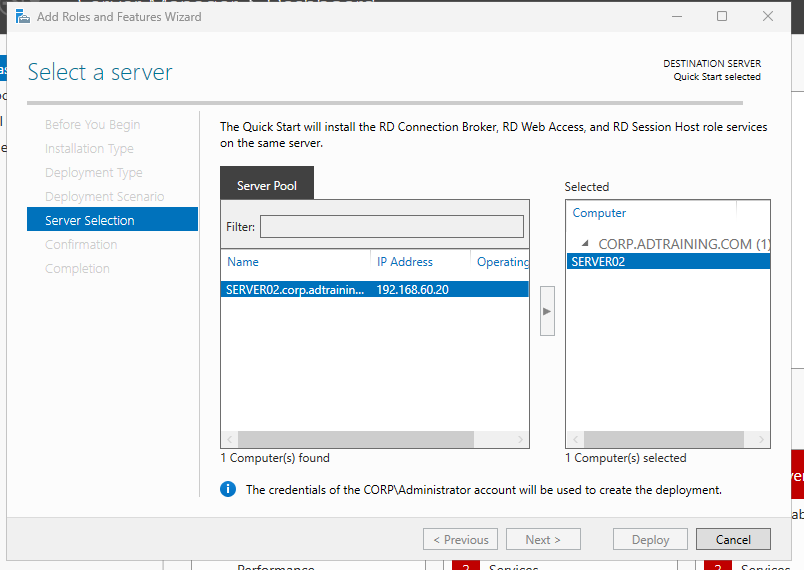
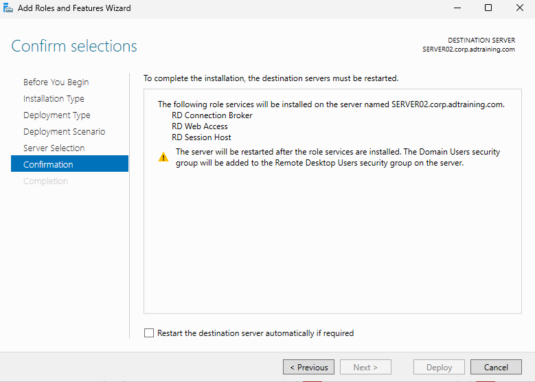
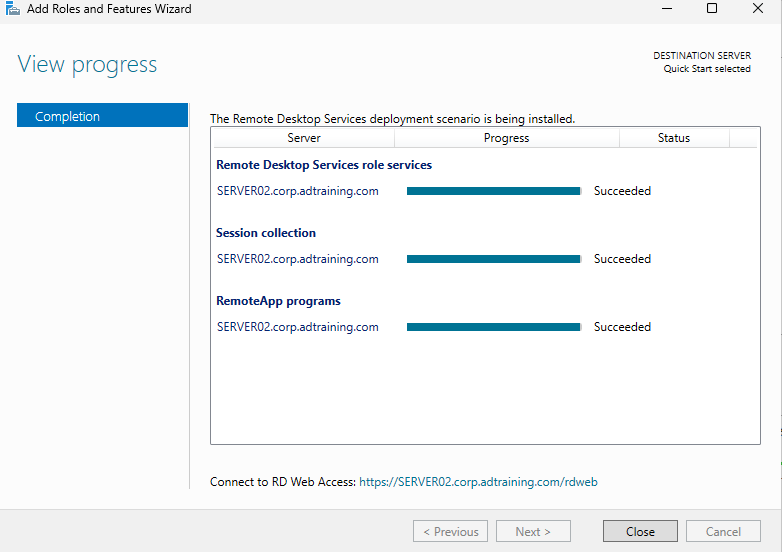
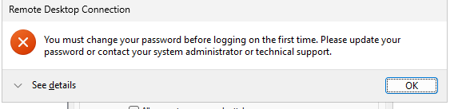
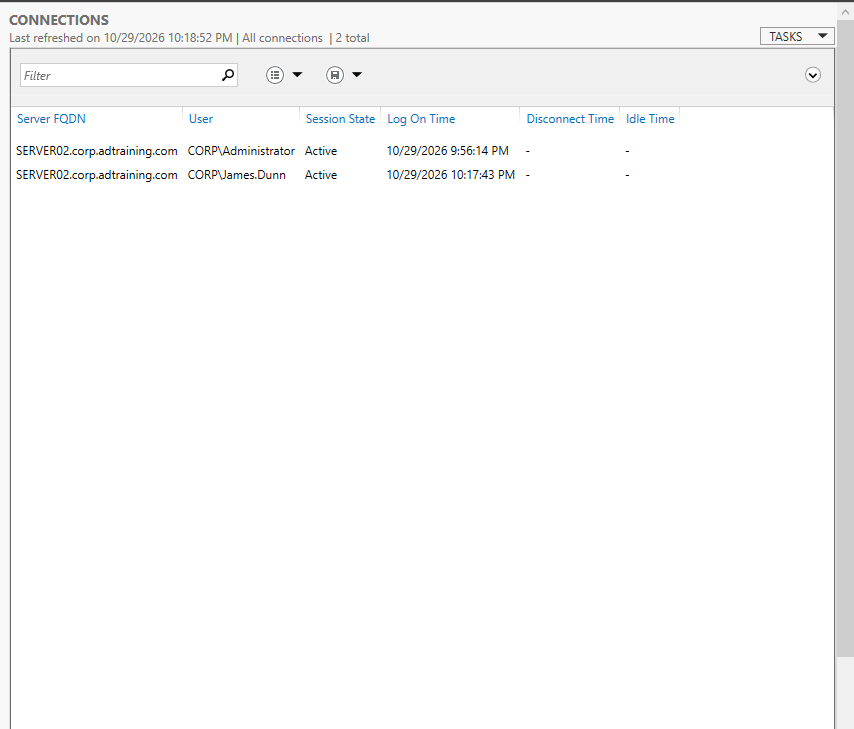
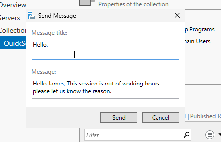
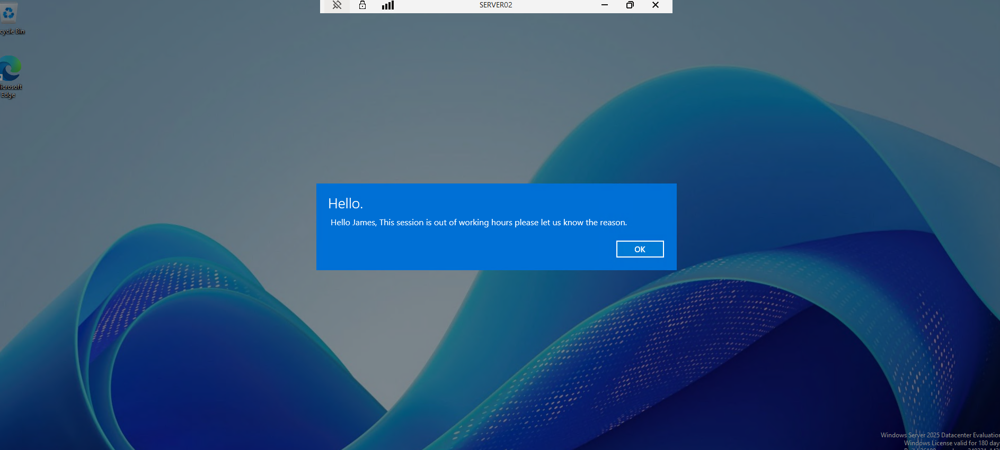

# Remote Desktop Services: Deployment & User Session Management

## Objective

Deploy a single-server RDS Quick Start environment on SERVER02, connect with a domain test user, and practice monitoring and messaging a session.

## Environment

| Component | Value |
|---|---|
| RDS member server | `SERVER02.corp.adtraining.com`, `192.168.60.20` |
| Domain controller / DNS | `DC01.corp.adtraining.com`, `192.168.60.10` |
| Domain | `corp.adtraining.com` |
| Deployment account | `CORP\Administrator` |
| Test user | `CORP\James.Dunn` |
| Deployment type | Quick Start, session-based |

## Deployment

### Verify the Target and Account

After joining SERVER02 to the domain and signing in with a domain account, selected SERVER02 in the RDS installation wizard.

### Confirm Role Services

Quick Start placed these role services on SERVER02:

- **RD Connection Broker:** Coordinates session connections and reconnection.
- **RD Web Access:** Provides the web access component for published resources.
- **RD Session Host:** Hosts users' sessions and applications.

The wizard also stated that Domain Users would be added to the server's Remote Desktop Users group. This is a broad lab default, not a least-privilege access design for production.

### Verify Deployment Completion

The completion screen reported **Succeeded** for RDS role services, session collection, and RemoteApp programs.

The wizard displayed `https://SERVER02.corp.adtraining.com/rdweb`. Deployment success does not establish that RD Web or individual published applications were tested.

## User Connection and Password Prerequisite

An initial connection attempt reported that the test user must change the password before first logon.

The later successful session establishes that this no longer blocked the test user. The exact password-change procedure was not captured, so no specific recovery method is claimed. Passwords are excluded from this documentation.

Used SERVER02 as the target and `CORP\James.Dunn` as the domain user. The Connections view later showed James.Dunn as Active alongside the Administrator session.

## Session Administration: Send a Message

From the collection's session-management interface, composed a practice message addressed to James's session.

The matching message appeared inside the remote desktop, whose connection bar identified SERVER02.

The working-hours wording was manually entered. It does not demonstrate automatic after-hours detection, a logon-hours policy, or enforcement of working hours.

## Validation Summary

| Test | Evidence |
|---|---|
| Role-service deployment | All three completion stages show Succeeded |
| Domain-user session | Connections view shows `CORP\James.Dunn` Active on SERVER02 |
| Session messaging | Matching composed and received messages |
| RD Web access | Not tested |
| Individual RemoteApp launch | Not tested |
| Licensing configuration / CAL assignment | Not documented |
| Control Panel GPO enforcement | Not tested during this exercise |

## Outcome and Scope

Deployed RDS on a separate domain member server and demonstrated a domain-user session, administrative session visibility, and message delivery. This extends the project beyond installation screenshots into observable user-facing behavior.

This is an internal Quick Start lab, not a production-ready or internet-facing RDS deployment. Certificate trust, licensing, restricted access groups, gateway design, and availability have not been validated.

[Previous: Member Server Domain Join](07-member-server-domain-join.md) | [Project overview](README.md)
