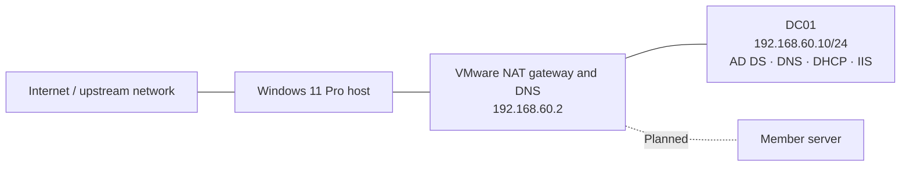
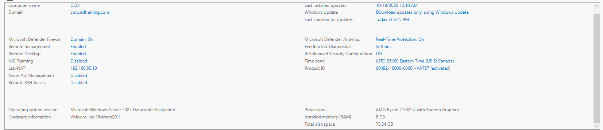
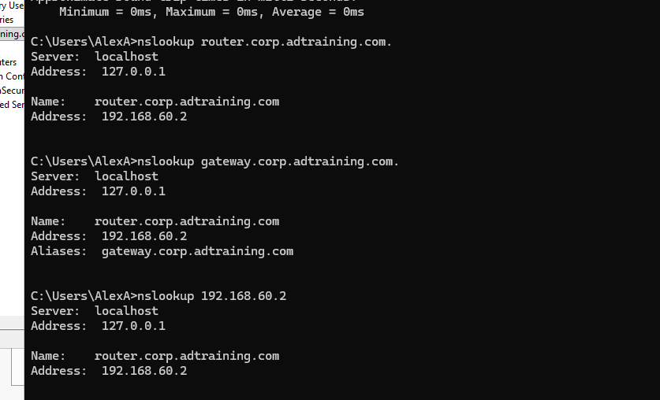
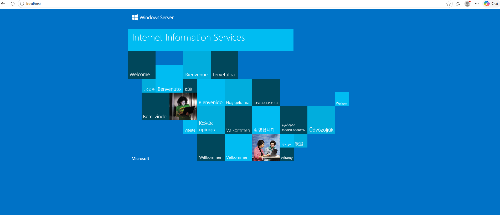

# 🖥️ Windows Server Administration & Infrastructure Lab

**Status: In progress** | Windows Server 2025 · Active Directory · DNS · Group Policy · DHCP · IIS

## Overview

This project documents my hands-on Windows Server homelab as I prepare for system administration roles. I am building a simulated business environment to practice identity administration, name resolution, policy management, and server services.

The lab follows exercises from Udemy's *Ultimate System Administrator Course*. This repository records my own configuration, screenshots, validation results, and troubleshooting. It distinguishes configured settings from behavior I have tested.

## Environment

| Component | Configuration |
|---|---|
| Host | Windows 11 Pro; AMD Ryzen 7 5825U; 32 GB RAM |
| Virtualization | VMware Workstation Pro 26H1 |
| VM storage | Samsung T7 Shield 1 TB external SSD |
| Server | DC01 — Windows Server 2025 Datacenter Evaluation |
| VM resources | 8 GB RAM; 8 virtual processors; 80 GB virtual disk |
| AD domain | `corp.adtraining.com` |
| Server FQDN | `DC01.corp.adtraining.com` |
| Server IPv4 | `192.168.60.10/24` |
| Network | VMware NAT; adapter named `Lab-NAT` |
| Default gateway | `192.168.60.2` |
| DNS client | DC01's local DNS service (`127.0.0.1` observed) |
| DNS forwarder | VMware NAT DNS service at `192.168.60.2` in captured configuration |

All server roles currently share DC01 for learning purposes. A separate member server is planned; this is not a production deployment design.

## Network layout



The private lab subnet is `192.168.60.0/24`. DC01 uses a static address. VMware DHCP was configured to allocate `.128–.254`; the Windows DHCP scope being configured uses `.100–.120`. VMware DHCP coordination and Windows client leasing remain unfinished.

## Lab chapters and evidence

| Area | Work performed | Evidence and validation |
|---|---|---|
| **Active Directory foundation** | Installed AD DS/DNS and promoted DC01 into a new forest | [Domain, IP, and directory baseline](Screenshots/01-AD-DNS-Baseline/) |
| **DNS administration** | Created A, CNAME, and PTR records and a reverse lookup zone | [Configuration and successful lookups](Screenshots/02-DNS-Records/README.md) |
| **Users, groups, and OUs** | Created a custom OU hierarchy, six users, and two security groups; assigned group membership and user attributes | [Identity administration evidence](Screenshots/03-Users-Groups-OUs/README.md) |
| **Group Policy** | Linked a Control Panel restriction GPO to the EndUsers OU; selected the user policy's Enabled setting | [GPO link and editor evidence](Screenshots/04-Group-Policy/README.md); user enforcement test pending |
| **FSMO discovery** | Queried the current holders of all five FSMO roles | [Role-holder baseline](Screenshots/05-FSMO-Roles/README.md); all five held by DC01, no transfer demonstrated |
| **DHCP** | Installed the role, authorized DC01 in AD, and configured scope settings in the wizard | [Authorization and scope evidence](Screenshots/06-DHCP/README.md); final scope state and client leases unverified |
| **IIS** | Installed IIS and ran the Default Web Site | [IIS Manager and localhost test](Screenshots/07-IIS/README.md); remote access not yet tested |

### DNS records validated

| Type | Name / address | Target |
|---|---|---|
| A | `router.corp.adtraining.com` | `192.168.60.2` |
| CNAME | `gateway.corp.adtraining.com` | `router.corp.adtraining.com` |
| PTR | `192.168.60.2` | `router.corp.adtraining.com` |
| PTR | `192.168.60.10` | `dc01.corp.adtraining.com` |

Forward, alias, and reverse queries returned the expected values using `nslookup`. The router records name the existing VMware gateway; they do not create a router or change routing.

### Directory structure

```text
corp.adtraining.com
└── CorpAdTraining
    ├── EndUsers
    │   ├── Alberto Meronta
    │   ├── Brad Coop
    │   ├── Clifford Morehouse
    │   ├── James Dunn
    │   ├── Mike Frank
    │   └── Rodger Phillips
    └── Security Groups
        ├── HR-Staff
        └── IT-Admins
```

Clifford Morehouse is shown as a member of `IT-Admins`. Creating a group with that name does not itself grant administrative privileges; effective permissions have not been demonstrated.

## Selected validation

### Domain configuration



### DNS records



### IIS



The IIS test confirms local HTTP delivery. It does not establish access from another machine or HTTPS configuration.

## Troubleshooting and lessons learned

| Symptom | Investigation and outcome |
|---|---|
| VM received a `169.254` address with no gateway | Switching from bridged networking to NAT produced a valid DHCP lease. The underlying bridged-network failure was not isolated. |
| Domain-controller prerequisites failed | The wizard reported an unsuitable built-in Administrator password. After setting that account's password, promotion proceeded and the domain was subsequently verified. |
| External DNS lookup returned `facebook.com.adtraining.com` | Inspected the DNS suffix search settings. Using an absolute name with a trailing dot, or `set nosearch` within nslookup, returned the intended external name. No server configuration change was needed for this test. |
| DC01 reverse lookup needed validation | Added its PTR record, corrected a hostname typo, and verified `192.168.60.10` resolved to `DC01.corp.adtraining.com`. |
| DHCP authorization wizard failed | Domain discovery tests succeeded. A later query in the earlier session returned Access denied. Using elevated PowerShell under the domain Administrator account, authorization was registered and verified with `Get-DhcpServerInDC`. This does not prove the cause of the initial wizard error. |
| Authorization wizard later reported error 20079 | The server was already registered in AD. The DHCP service was restarted, and post-install configuration was reported complete. |
| All role tiles showed red Manageability alerts | The detail view reported **Online – Restart pending**. Restarting Windows Server and allowing inventory to load cleared the alerts. |

## Remaining work

- [ ] Join a separate member server to the domain and document DNS/domain discovery from that machine.
- [ ] Verify the GPO's saved setting and demonstrate enforcement for a user in EndUsers on a suitable domain-joined machine.
- [ ] Verify final DHCP scope options, including gateway and DC01 as the client DNS server.
- [ ] Coordinate VMware DHCP before activating Windows DHCP; validate a client lease, gateway, DNS settings, and connectivity.
- [ ] Test IIS from another lab machine.
- [ ] Add file services, group-based permissions, and backup/restore exercises as the lab expands.

## Skills practiced

Windows Server deployment · AD DS and DNS administration · User and group management · OU organization · Group Policy configuration · DHCP authorization · IIS administration · PowerShell diagnostics · Troubleshooting · Technical documentation

## Repository contents

Each numbered folder under `Screenshots/` contains selected evidence; most also include a short lab summary. Screenshots establish the state captured at that point, not continuous service health.

Only documentation and reviewed lab evidence belong in the public project. VM disks, installation media, credentials, and personal administrative notes are excluded from the intended publication scope. User/contact fields in screenshots should be checked for personal information before publication.
